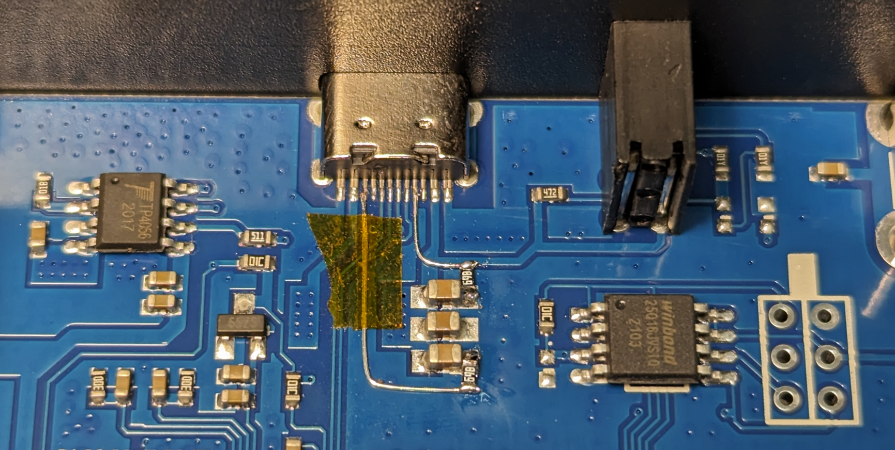

The scope is charged from USB C connector and needs 5V only, but does not charge from the PD chargers due to lack of 5.1k pull-down resistors on CC1/CC2 pins of the USB C. Annoying and strange to say the least. Let's fix that: 
